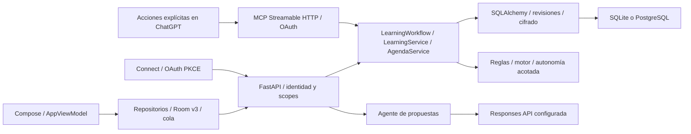

# Arquitectura

Android nativo (Compose/Material 3) observa Room mediante StateFlow. AppViewModel coordina acciones, estados de carga/errores y guardados; los repositorios validan y persisten. MainActivity contiene el ciclo de vida y composición de rutas; CalendarScreen, ActivityScreens, SettingsScreen y LearningScreens separan responsabilidades visuales. No hay claves de IA en Android. Hay cuatro destinos principales y configuración secundaria.

FastAPI y MCP son adaptadores de entrada de los mismos servicios. LearningWorkflow coordina el registro educativo y la finalización de agenda en una transacción. LearningService administra la memoria y AgendaService la agenda con comparación optimista de revisión. El agente devuelve propuestas tipadas; no recibe herramientas de escritura ni conexiones SQL. planning_rules contiene restricciones compartidas por generador, validador y experimento CP-SAT. autonomy aplica exclusivamente el subconjunto autorizado y conserva reversión.

Los agregados de agenda y aprendizaje conservan revisiones independientes para proteger clientes anteriores. No se normalizan tablas por entidad sin necesidad: se preserva el contrato existente y se agrega fusión de agenda por entidad/campo. Memoria usa comandos idempotentes y correcciones versionadas. La vinculación asocia una identidad OAuth vacía con un espacio existente después de demostrar ambos accesos; no copia bases ni adivina usuarios.

Dependencias de dominio no importan UI, transporte MCP ni proveedor de IA. SQL queda en servicios de persistencia, no en endpoints nuevos; la API legacy de sincronización se conserva por compatibilidad y se documenta como reemplazo CAS. No se añade una capa genérica por cada archivo. Ver ADR 0002 para límites, alternativa al reemplazo y decisiones de producción.

Límites: agregados acotados (2000 actividades, 10000 sesiones), no colaboración masiva. Cuotas por proceso, un worker de producción. PostgreSQL probado en integración; un proveedor OAuth y ChatGPT reales siguen siendo pasos externos.
