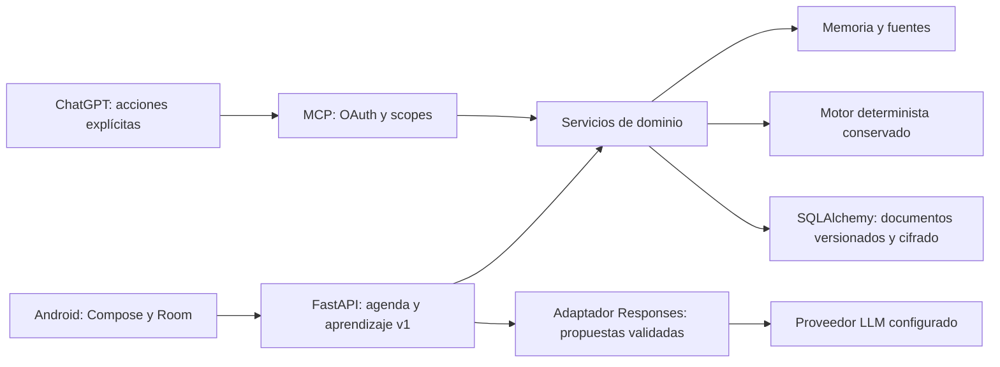

# Arquitectura de CalenFleX

El repositorio original solo tenía README.me y .gitignore. Este desarrollo crea un motor nuevo; las pruebas son nuevas, no las 54 mencionadas en el pedido original.

## Android

Aplicación nativa Kotlin con Compose Material 3 y Navigation Compose. AppViewModel publica StateFlow y coordina Repository. Room guarda un documento transaccional versionado (actividades, recurrencias, franjas, horarios, preferencias e historial) en SQLite. Cada escritura es atómica y marca la versión como pendiente de sincronización. DataStore guarda la conexión. El token se cifra con AES-GCM y una clave de Android Keystore. No hay claves de IA en el APK. Se desactiva el backup automático de Android para evitar restaurar credenciales sin su clave.

La persistencia en un documento simplifica las copias coherentes y la sincronización de un espacio personal pequeño (máximo 2000 actividades); leer todo el documento no escala a equipos grandes. Es una elección consciente de esta versión, no una base relacional consultable por actividad.

## Servidor

FastAPI/Pydantic valida los contratos. SQLAlchemy persiste un documento con revisión por espacio personal en SQLite. Un servidor equivale a un usuario/espacio y se protege con CALENFLEX_TOKEN. No ofrece registro de usuarios ni recuperación de contraseñas. HTTPS es obligatorio desde Android. El servidor usa consultas con comparación de revisión para impedir actualizaciones perdidas.

## Planificación

El motor determinista se ejecuta en el backend. Prioriza horarios fijos, prioridad (1 es la mayor), fecha límite e identificador estable. Busca por día y cercanía al horario preferido, en pasos de cinco minutos. Las restricciones duras incluyen disponibilidad, franjas, días, exclusiones, bloqueos, anticipación, fechas límite y transición. Las ocurrencias completadas y los horarios fuera del horizonte se conservan. Las recurrencias mensuales del día 31 se ajustan al último día del mes.

Es un algoritmo voraz: no garantiza el óptimo global ni el máximo número de actividades. Devuelve pendientes con explicación cuando no encuentra lugar. La IA nunca modifica este algoritmo. Los planes se previsualizan y requieren aceptación; aplicar una propuesta calculada sobre datos ya editados se rechaza.

## Sincronización

Cada documento tiene revisión remota y un indicador local de cambios. Sin cambios, se descarga la versión remota; con cambios, se envía una escritura con la revisión esperada. Un 409 conserva ambas versiones y requiere una decisión explícita en Perfil. No hay fusión automática. UUID y validación de ocurrencias evitan duplicados. WorkManager reintenta ante errores transitorios. Los cambios locales quedan en disco hasta sincronizar. Exportar una copia antes de resolver conflictos permite conservar la versión descartada.

## IA

Adaptador HTTP OpenAI-compatible, configurado por entorno. No puede guardar ni aplicar planes. Respuestas estructuradas se validan con Pydantic y las propuestas se revisan en el formulario. Timeout de 30 segundos, límite de respuestas y máximo horario por proceso. Para varios procesos, el límite de costo debe imponerse también en el proveedor o gateway.

# Evolución 1.1

Las secciones anteriores documentan la versión inicial. Ahora existe aislamiento por principal y permisos, memoria educativa versionada en learning_documents, propuestas de agenda con revisión/vencimiento/reversión y auditoría sin contenido privado. Las migraciones SQL 1–4 son aditivas y el documento de agenda anterior permanece intacto. Los payloads pueden cifrarse con un sobre autenticado y clave de despliegue; producción exige configurarla.

Android migra Room 1→2 agregando learning_cache para memoria, sesión en curso y cola persistente. La agenda y la memoria usan revisiones independientes. Los clientes antiguos no escriben learning_documents. La navegación actual es Hoy/Agenda/Objetivos/Asistente, con configuración y estadísticas secundarias.

El servidor MCP usa el SDK oficial y servicios compartidos, sin duplicar el planificador ni simular llamadas a ChatGPT. El proveedor OAuth externo y el hosting HTTPS son configuración pendiente del despliegue, no servicios inventados. Ver ADR 0001, MCP.md y OPTIMIZATION.md para decisiones, alcances y pendientes.
